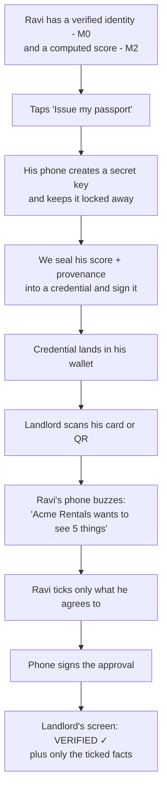

# M3 — The Passport, Explained in Plain English
### "We already have a score. Why build all this?" — the no-jargon version

> Companion to [PRAVAAH-EXPLAINED-SIMPLE.md](PRAVAAH-EXPLAINED-SIMPLE.md).
> Read that first if you haven't. This one zooms into **M3**, the module that turns
> Ravi's score into something he actually *owns*.

---

## 1. The one-sentence idea

> **M2 gave Ravi a score. M3 gives Ravi the score.**

Read that twice, because the whole module lives in that difference.

After M2, Ravi's reputation score exists — as a **row in our database**. It's real, it's
explainable, it's fair. But it belongs to *us*. If a landlord in Singapore wants to know
whether Ravi is trustworthy, he has to come and ask Pravaah.

M3 takes that number and hands it to Ravi as a **document he carries** — sealed, tamper-proof,
and checkable by anyone, **without asking us anything**.

---

## 2. Why "a score in our database" isn't good enough

Imagine Ravi walks into a Singapore rental office.

**Without M3:**

> Landlord: "Prove you're financially reliable."
> Ravi: "Sure — there's an Indian company called Pravaah, they have my score. Call them?"
> Landlord: "...who? No."

Even if the landlord *did* call us, look at what that world requires:

- The landlord must **sign up with us**, trust us, integrate with us.
- **We** must be online at that exact moment, or the check fails.
- **We** learn that Ravi is renting a flat in Singapore this Tuesday. We're now watching him.
- Ravi is a middleman away from his own reputation. He can't *show* anything; he can only
  point at someone else who might vouch for him.

**With M3:**

> Ravi taps his phone.
> The landlord's screen says: *"Verified by PRAVAAH. This person is GOOD or better."*
> Done. Nobody called us. We don't even know it happened.

That's the shift. The score stops being **a fact we hold about Ravi** and becomes
**a document Ravi holds about himself**.

---

## 3. The core analogy: the sealed envelope wallet

Think of your degree certificate.

A paper certificate is **all-or-nothing**. Hand it over and the reader sees everything on it:
your name, your date of birth, your grades, your university, the year. You cannot show only
the part that says "yes, he graduated."

Now imagine a strange kind of certificate:

- Every single fact on it sits in **its own sealed envelope**.
- The whole bundle carries **one official wax seal** across it, so nobody can add, remove, or
  edit an envelope without visibly breaking the seal.
- You choose **which envelopes to hand over**. The ones you keep aren't blacked out or
  folded over — they are genuinely **unreadable**. Not hidden. Unreadable.
- And the bundle only works when **you** are holding it. A photocopy is worthless.

That is a **Verifiable Credential**, and that's what M3 issues. The technical name is
**SD-JWT VC** — "SD" for *Selective Disclosure*, the envelope trick.

---

## 4. The four powers, one at a time

Everything M3 does comes down to four properties. Here they are without jargon.

### Power 1 — It's sealed, so it can't be faked or edited

We sign the credential with a private key only Pravaah has. That signature covers every fact
inside it.

Change one character of Ravi's score, and the seal no longer matches. The landlord's app
notices instantly.

**And here's the clever part:** we publish our *public* seal-checking key at a fixed web
address —

```
https://pravaah.app/.well-known/did.json
```

Any app, anywhere in the world, can fetch that and check our signature. Nobody needs
permission, an account, or a contract with us.

> **Analogy:** a passport office publishes what its official stamp looks like, so every border
> in the world can check a passport without phoning the office that issued it.
> That web address is Pravaah's published stamp.

### Power 2 — It only works in Ravi's hands (the anti-theft part)

This is the one people underestimate.

When Ravi's phone creates his passport, the phone first generates a **secret key** and keeps it
locked in the phone's secure storage. It **never** leaves the phone — not to us, not to anyone.
We only ever see the matching *public* half, which we bake into the credential.

Now, every single time Ravi shows his passport, his phone must **sign a fresh little note**
saying *"yes, I'm the real holder, and I approve this specific share, right now, for this
specific person."*

So:

| Someone steals... | What can they do? |
|---|---|
| A screenshot of the credential | **Nothing.** No phone, no signature. |
| The whole credential file | **Nothing.** Same reason. |
| **Our entire database** | **Nothing.** We never had Ravi's secret key. |

> **Analogy:** a debit card that is useless without your fingerprint. Copying the card gets a
> thief a piece of plastic.

### Power 3 — Ravi chooses what to reveal (the star feature)

This is the part nobody else in the market offers, so it's worth going slowly.

When we create Ravi's passport, we do **not** write his score onto it. Instead, for every fact,
we write a **scrambled fingerprint** of it — a one-way scramble. You can go
fact → fingerprint, but you can *never* go fingerprint → fact.

The credential Ravi carries therefore looks roughly like:

```
Officially sealed by PRAVAAH. Contains 17 facts:
  fingerprint#1  ██████
  fingerprint#2  ██████
  fingerprint#3  ██████
  ... (14 more)
```

Alongside it, Ravi's phone quietly holds the **actual 17 facts**.

When the landlord asks a question, Ravi hands over the sealed bundle **plus only the facts he
picks**. The landlord scrambles each revealed fact himself and checks it matches a fingerprint
in the sealed bundle. If it matches — that fact is genuine, signed by Pravaah, unedited.

And the 14 facts Ravi didn't reveal? The landlord has nothing but scrambled fingerprints.
They are **mathematically unreadable**, not merely withheld.

Look at what this makes possible, from **one single credential**:

| Who's asking | What they need | What they actually see |
|---|---|---|
| Small loan app | Just "is he good enough?" | `Good or better: yes` — **and nothing else** |
| Bank pricing a loan | The exact number | Name, score `759`, confidence, date |
| Singapore landlord | Identity + reliability | Name, nationality, passport no., band `VERY GOOD` |
| Insurance quote | Risk detail | Score, confidence, data quality, model version |
| Age-restricted service | Just identity | Name, nationality — **zero financial info** |

The first row is the most important line in this entire document. **A real lending decision,
made on one word, revealing nothing else about Ravi.** No name. No number. No date of birth.

#### One subtle trick worth knowing

We put **four** "at least" facts on every passport:

```
at least FAIR       : yes
at least GOOD       : yes
at least VERY GOOD  : yes
at least EXCELLENT  : no      ← we include the "no" too!
```

Why include a fact whose answer is *no*? Because if we only wrote down the true ones, then
**counting the fingerprints** would give away Ravi's band without him revealing anything. An
excellent holder's passport would visibly have more fingerprints than a fair holder's.

By always writing all four, every passport has the exact same shape. There is nothing to
count. Small detail; without it, the entire selective-disclosure promise leaks.

### Power 4 — It can be cancelled, and checked offline

Passports get lost. Phones get stolen. Scores go stale. So a credential must be cancellable.

The obvious way would be an endpoint: *"Hey Pravaah, is credential #4821 still valid?"*

**We deliberately did not do that**, because it would make us a surveillance point on every
single credit check our own users submit. Every question tells us who is being checked, by whom,
and when.

Instead we publish a **single list of on/off switches** — one tiny switch per credential —
as one file. A verifier downloads the **whole list** and looks up the one they care about,
themselves.

> **Analogy:** instead of phoning the passport office to ask "is Ravi's passport cancelled?",
> the border guard downloads the entire cancelled-passports list once a day and checks it
> locally. The office never learns who was checked.

That means:
- **We never learn** who is being verified. Downloading a list reveals nothing.
- Verification works **offline**. Cache the list, and no internet is needed at all.
- Cancelling is **instant and global** — one switch flips, and every verifier on earth
  rejects it from that moment.

---

## 5. Ravi's actual journey, step by step



### What Ravi sees on the consent screen

This screen is the heart of the product, so we wrote it carefully. Every request shows, for
each fact:

- **A human name** — "Passport number", never `passport_number`
- **What he's actually giving away** — *"Your passport number, masked to the last four
  characters, tying this credential to the document you already travel on."*
- **Why someone would legitimately ask** — *"Only for genuinely cross-border use — a foreign
  landlord linking your reputation to the ID they already trust."*

And three rules the screen obeys:

1. **Nothing is pre-ticked.** A pre-selected box isn't a choice, it's a default you're asked
   to notice.
2. **He can always share less** than was asked. Or nothing at all.
3. **"Decline" sits right next to "Share"** — not buried at the bottom.

Sharing *nothing at all* is still meaningful, by the way. It proves *"Pravaah issued a live,
uncancelled passport to the person holding this phone"* — which is a real, useful fact, and
the most private one available.

Afterwards he gets a **receipt**: exactly what was shared, exactly what was kept private, and
who received it. Every share is logged in "Who has seen it" forever.

---

## 6. The physical card

Ravi also gets an optional **plastic card** — bank-card sized, which is (not by coincidence)
the exact size the international standard uses for identity cards.

The important question: **isn't a card dangerous? What if he loses it?**

No, because of one design decision: **the card contains a reference, never the credential.**

Scanning or tapping the card doesn't reveal anything. It just *opens a request* — which then
needs Ravi's phone to approve and sign it.

So:
- Someone photographs the QR over his shoulder → **useless**
- Someone steals the card from his wallet → **useless**
- Ravi reports it lost → the reference is switched off, and he gets a replacement

The card has a printed machine-readable strip too — the same three-line format at the bottom
of a passport, with real check digits that actually verify. Partly practical, partly because
a reputation document should *feel* like a document.

---

## 7. What's inside the credential — and what is very deliberately not

**What travels:**

- The score (`759`) and its band (`VERY GOOD`)
- How confident we are, and how complete the underlying data was
- The date the data reflects
- Which **model version** produced it
- Which **regulated rails** the data came from (`AA-IN`, `SGFinDex`)
- Which consent it was computed under
- His verified name, nationality, and optionally his passport number
- How strongly his identity was checked

**What NEVER travels:**

- ❌ Transactions
- ❌ Balances
- ❌ Account numbers
- ❌ Who he pays or who pays him
- ❌ Anything a bank statement would show

This is not a policy promise — it's structural. The issuer code simply has no path from a
transaction to a credential.

And it answers the hardest regulatory question in one line:

> **Raw Indian bank data never leaves India. Only the derived score crosses the border.**

The heavy, sensitive data stays under Indian regulation in M1. What travels to Singapore is a
single number and its paperwork.

---

## 8. Why this is the module that makes Pravaah unique

India has Account Aggregator. Singapore has SGFinDex. Both are genuinely good — they let you
**move your data** between regulated institutions.

But notice what they give you: **portability of data, inside the system.** You still can't
*hold* anything. You can't walk into a room and show something. You're still asking
institutions to talk to each other about you.

> Account Aggregator and SGFinDex give you **data portability**.
> **Nobody gives you a portable, owned, presentable reputation object.**

That gap is M3. It's the difference between *"my data can be sent somewhere"* and
*"here, look at this — I'm holding it."*

---

## 9. What actually got built

**Backend** (`apps/pravaah-be/src/modules/passport/`)
- The credential-signing machinery, written on Node's own crypto
- The trust anchor — the public web addresses where our keys live
- The cancellation list, itself signed so nobody can tamper with it in transit
- The verifier ⇄ holder handshake behind a card tap
- The physical card, including a QR generator and the passport-style printed strip
- Background safety nets — the most important one cancels any credential whose consent or
  score has died, because a live credential with no permission behind it is the single worst
  thing this module could produce

**The wallet** (`apps/pravaah-rn/src/features/passport/`)
- The device key (the part that makes theft pointless)
- The passport, drawn as an object he holds
- The consent-to-disclose screen
- The card screen and the share history

**The admin console** (`apps/pravaah-admin/app/dashboard/`)
- Every issued passport, and every share — including the **refused** ones, because a run of
  refusals against one credential is what an attempted theft looks like
- The issuer keys
- Registered verifiers

One deliberate limit worth knowing: **the admin console cannot see anyone's claim values.** It
can see that a passport asserts a nationality. It cannot see which one. That's enforced in the
backend, not just hidden in the UI.

---

## 10. See it work yourself

```bash
# The whole loop against the real database:
# issue → share selectively → verify → try every attack → cancel → rejected
cd apps/pravaah-be && npm run verify:passport

# Proves the wallet's signatures are ones the backend will actually accept
cd apps/pravaah-rn && npm run verify:holder-key
```

The first one prints ~55 checks. The interesting ones are the attacks it **refuses**:

```
✓ a STOLEN credential without the device key is refused
✓ disclosures swapped AFTER signing are detected
✓ a presentation relayed to another verifier is refused
✓ the exact score is cryptographically invisible
✓ the SAME presentation is now rejected as revoked
```

Every request is also written up in
[`apps/pravaah-be/docs/api-tests/m3-passport.http`](apps/pravaah-be/docs/api-tests/m3-passport.http).

---

## 11. The one analogy that ties it all together

**M0** checked Ravi is a real, verified person.
**M1** got his permission to look at his financial life, through a regulated pipe.
**M2** read that life and wrote down one honest, explainable number.

**M3 takes that number, prints it on a sealed document, locks it to Ravi's phone, and hands it
to him** — so he can walk into any room in either country and prove exactly as much as he
chooses, to someone who has never heard of us, without us ever knowing it happened.

Everything before M3 built the trust.
**M3 is the moment we give it away — to the person it belongs to.**

---

## 12. The single sentence to remember

> **M3 turns Pravaah from a company that knows Ravi is trustworthy
> into a document Ravi carries that proves it.**
