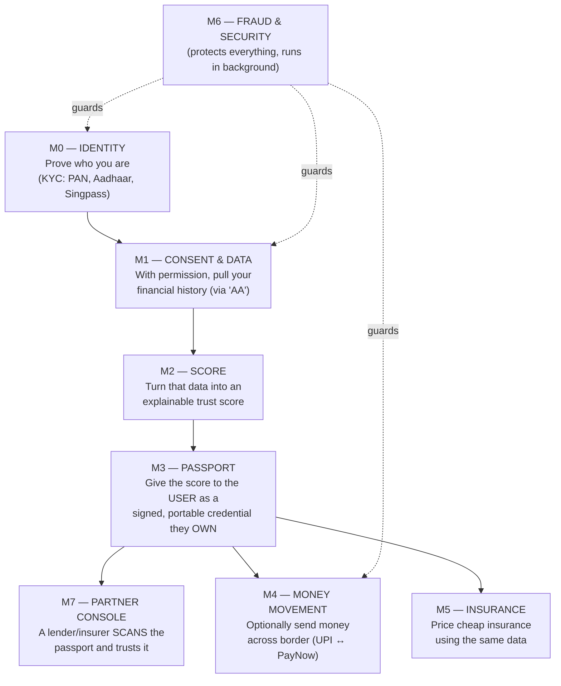
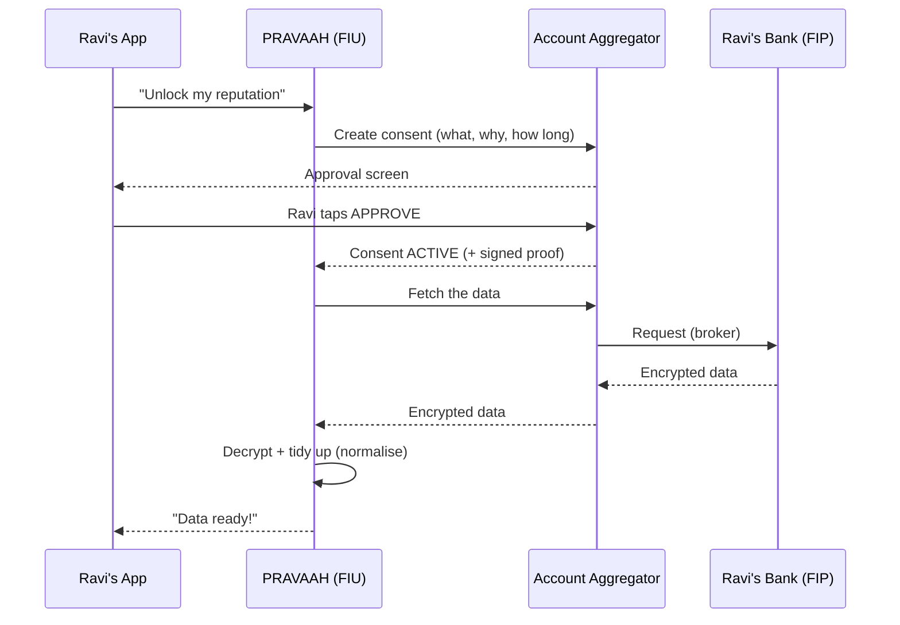

# PRAVAAH — Explained in Plain English
### "What are we actually building, and why?" — the no-jargon version

> Read this top to bottom once. By the end you'll understand the whole project,
> why each step exists, what "AA" means, and why this is **much bigger than a UPI app**.

---

## 1. The one-sentence idea

> **PRAVAAH lets a person carry their financial reputation across a border.**

That's it. Everything we build serves that one goal.

Think of it like a **passport for your money-trustworthiness**. A normal passport proves
*who you are* to any country. PRAVAAH proves *how financially trustworthy you are* to any
bank, landlord, or insurer — even in a different country.

---

## 2. The real problem we are solving (the "why")

Meet **Ravi**.

- Ravi lived in India for years. He has a salary, a bank history, he pays his bills on time,
  he has a good credit score. In India, banks **trust** him. He can get a loan, rent a house,
  buy cheap insurance.
- Ravi moves to **Singapore** for a job. The moment he lands, he becomes a **"nobody"** to the
  financial system there.
  - No local credit history → **no loan**.
  - No proof he pays rent on time → **landlord rejects him** or asks for huge deposit.
  - Insurers don't know him → **expensive or no insurance**.

Ravi's 7 years of good financial behaviour **died at the airport**. This happens to millions
of migrant workers, students, and founders who move between countries.

**PRAVAAH fixes this.** It lets Ravi *unlock* his India financial history, turn it into a
score everybody understands, and **carry it to Singapore as a credential he owns**.

---

## 3. "But I thought I was building a UPI app?" — clearing the confusion

This is the #1 thing confusing you, so let's kill it now.

**UPI (money transfer) is only ONE small piece of PRAVAAH — and not even the most important one.**

PRAVAAH is really a **trust / reputation system**. Moving money (UPI ↔ PayNow) is just the
*last step* — after we've proven the person is trustworthy. The hard, valuable part is
**building and proving the trust**, not sending the rupees.

| What you thought | What it actually is |
|---|---|
| A UPI payments app | A **financial reputation passport**. UPI is just 1 of 8 modules (module M4). |
| Send money A → B | Prove *who* someone is, *how trustworthy* they are, let them *own* that proof, THEN optionally move money. |
| One feature | 8 connected modules (M0–M7), each building on the previous one. |

So: **payments are the easy, small part at the end. The real product is trust that travels.**

---

## 4. The whole journey of a user (the big-picture flow)

Here is the entire product as one story. Each step is a "module" (M0, M1, ...).



**Read it as a sentence:**
> First we prove *who you are* (M0). Then, *with your permission*, we pull your financial
> history (M1). We turn it into a *score with reasons* (M2). We hand that score to *you* as a
> credential you own and can show anyone (M3). A lender scans it and trusts you (M7), then money
> flows (M4) and insurance is priced fairly (M5). Fraud protection (M6) sits underneath all of it.

Notice: **money movement (M4) only happens AFTER trust is built.** That's why UPI is not the point.

---

## 5. Each module in one plain line

| Module | What it does (plain English) | Real-life analogy |
|---|---|---|
| **M0 — Identity** | Confirms you are really you. | Showing your ID card at the door. |
| **M1 — Consent & Data** | *You allow us*, and we fetch your bank/financial history safely. | You unlock your bank statements and hand us a copy — but only what you agreed to. |
| **M2 — Score** | Converts messy financial data into one clear number + reasons. | A report card: "720. Good, because steady income; weak on savings." |
| **M3 — Passport** | Packages the score into a tamper-proof credential **you** carry. | A digital passport / certificate you keep in your wallet. |
| **M4 — Money** | Actually moves money across border. | The remittance / send-money button. (Small part!) |
| **M5 — Insurance** | Uses your data to offer fair, cheap insurance. | A tailored insurance quote instead of a blind one. |
| **M6 — Fraud/Security** | Keeps hackers, fake identities, and SIM-swaps out. | The security guards and cameras. |
| **M7 — Partner Console** | Where a bank/landlord checks your passport is real. | The border officer scanning your passport. |

You are meant to **build them in order (M0 → M1 → ...)** because each one needs the one before it.
You have **already built M0 and M1.**

---

## 6. Deep dive: M0 — Why do we take identity data first?

**The question:** Why start by collecting PAN, Aadhaar, bank account, Singpass, a selfie, etc.?

**The simple answer:** Everything after this *trusts* M0. If we get "who you are" wrong,
every later step is garbage — we'd be building a trust score for the wrong person, or a fraudster.

So M0's only job is: **prove, beyond doubt, that this person is real and is who they claim.**

How it proves it (India side, using a provider called **Decentro**):
1. **PAN check** — is this a real, valid tax ID, and whose name is on it?
2. **Aadhaar OKYC (via DigiLocker)** — pull the government's official record of this person.
3. **Bank "penny-drop"** — send ₹1 to their bank account; the bank replies with the account
   holder's real name. Confirms they own that bank account.
4. **Liveness + face match** — a live selfie (blink/turn) to prove it's a real human right now,
   not a photo of a photo, and that the face matches the ID.
5. **Name matching** — the name on the PAN, the bank, and the document must all agree
   (with smart handling for spellings/initials — a small mismatch goes to a human reviewer,
   it does **not** auto-reject).
6. **Sanctions check** — make sure they're not on a criminal/terror watchlist.

Singapore side uses **Singpass** (their national digital ID) — currently mocked with official
test personas, swappable to the real thing later.

Only when all of this passes does the user become **`VERIFIED`**.

> **Golden rule:** A user must be `VERIFIED` in M0 before M1 will do anything.
> No verified identity → no financial data → no score. Trust is a chain; M0 is the first link.

---

## 7. Deep dive: M1 — What on earth is "AA" (Account Aggregator)?

This is the part confusing you most, so slow down here. This is the **heart of the product.**

### The problem M1 solves
We need Ravi's **financial history** (bank transactions, deposits, GST/business income) to
score him. But:
- We can't just log into his bank — that would be illegal and insecure.
- Screen-scraping or asking for his bank password is dangerous and not allowed.

So how do we get his data **safely, legally, and only with his permission?**

### The answer: the Account Aggregator (AA) rail

India built an official government-backed system called the **Account Aggregator** framework.
Think of the AA as a **trusted middle-man / consent broker** sitting between banks and apps.

Here are the players (learn these 3 words and M1 makes sense):

| Word | Means | In our case |
|---|---|---|
| **FIP** | Financial Information **Provider** — the one that *has* the data | Ravi's **bank** |
| **FIU** | Financial Information **User** — the one that *wants* the data | **PRAVAAH (us)** |
| **AA** | Account **Aggregator** — the licensed broker in the middle | Companies like Finvu, OneMoney, Setu |

**Crucial:** the AA is just a **consent broker + secure pipe**. It **never sees your actual
data in readable form** — the data is encrypted from the bank straight to us. The AA only
carries the sealed envelope and manages permission.

### The AA flow in plain steps (a real-life analogy)

Imagine Ravi wants to give us a copy of his bank records, safely:

1. **We ask (create consent):** PRAVAAH sends a request: "May we see your DEPOSIT + GST data,
   for the purpose of a credit score, for the last 12 months, and keep it for X months?"
2. **Ravi approves at the AA:** He's shown *exactly* what we asked for, in plain language, and
   taps **Approve** on the AA's own screen. (Or rejects. His choice.)
3. **Consent becomes `ACTIVE`:** The AA tells us "he agreed" via a webhook (an automatic
   notification), plus a **signed document (consent artefact)** proving he really consented.
4. **We fetch the data:** We ask the AA for the data. The bank encrypts it and sends it
   through the AA to us.
5. **We decrypt it** on our server and **normalise** it (turn raw messy transactions into tidy
   features like "average balance", "monthly income", "income steadiness").
6. **Purpose + data-life rules:** We can only use it for the purpose he agreed to, and we must
   **auto-delete it** when the agreed time is up. If he **revokes**, we delete immediately.



### Why this is the "trust money-shot"
The single most powerful demo moment: Ravi taps **Revoke** in the app, and his data is
**instantly deleted**. That visibly proves *the user is in control of their own data* — which
is exactly what earns trust from users, banks, and hackathon judges.

### "Live" vs "Sandbox" — why there are two versions
Getting real AA credentials takes time and licensing. So we built a **`SandboxAaProvider`** —
a faithful fake that returns realistic dummy data — so we can build and demo the *entire* flow
**today**. When real credentials arrive, we swap to `SetuAaProvider` by changing **one line**.
The logic never changes. (Bonus: the real AA sandbox is legally required to use dummy data
anyway, so our mock behaves just like the real sandbox.)

> **This "swap one line to go live" pattern is used in M0 too** (Decentro, Singpass, biometrics
> all hide behind interfaces). It's a core design idea of the whole project: **business logic
> never talks to a vendor directly — always through an interface.**

---

## 8. How the modules chain together (the "chain of trust")

This is the mental model that makes everything click:

```
M0 proves:  "This is really Ravi."                    ← identity
     │
     ▼
M1 proves:  "Ravi AGREED to share THIS data."         ← consent + data  (needs M0 verified)
     │
     ▼
M2 produces: "Based on that data, Ravi scores 720,     ← the score       (needs M1 data)
              here's WHY."
     │
     ▼
M3 gives Ravi: a signed passport of that score          ← ownership       (needs M2 score)
              that HE owns and can show anyone.
     │
     ▼
M7 lets a bank: scan the passport and trust it          ← verification
     │
     ▼
M4/M5: money moves / insurance is priced.               ← the payoff
```

Each arrow means **"can't happen without the step before."** That's why order matters, and
that's why you start at M0.

---

## 9. Where UPI actually fits (so you stop worrying about it)

UPI ↔ PayNow lives in **M4**, near the end. It's the part where, *after* Ravi is trusted, he
can actually **send money home** or **receive a loan** across the India–Singapore border.

- It's genuinely useful (that corridor moves ~US$1B/year).
- But it's **one module out of eight**, and it only matters *because* of the trust built in
  M0–M3. Without the reputation passport, it's just another payment app — nothing special.

So: **build the trust engine first. UPI is the cherry, not the cake.**

---

## 10. What YOU have already built (grounding this in reality)

Based on the project so far:

- ✅ **M0 — Identity/KYC**: built. India via Decentro, Singapore via Singpass test personas,
  pluggable biometrics. The "swap one line to go live" pattern is in place.
- ✅ **M1 — Consent & Data Aggregation**: built and verified end-to-end using the sandbox AA
  provider. Consent lifecycle, revocation, data-life deletion all working.
- ✅ **Auth / OTP**: phone + email OTP login working (Supabase + MSG91 SMS + email).
- ✅ **pravaah-rn**: the user's mobile app (Expo) — KYC flow + consent flow screens.
  *(The file you have open, `consent/[id].tsx`, is the M1 consent detail screen.)*
- ✅ **pravaah-admin**: the admin dashboard (Next.js) — where staff review KYC cases.
- ⬜ **M2 (score), M3 (passport), M4 (UPI), M5 (insurance), M6 (fraud), M7 (partner)**: still ahead.

So you're **2 modules into an 8-module product**, and they're the two hardest, most important
foundational ones. You're on track.

---

## 11. The one analogy that ties it ALL together

Think of the whole thing as **getting and using a passport:**

1. **M0** = proving your identity at the passport office (documents, photo, verification).
2. **M1** = the office *gathering your records* — but only the ones you consent to hand over.
3. **M2** = they assess you and stamp a *rating* based on those records.
4. **M3** = they print the actual **passport** and give it to *you* to carry.
5. **M7** = an immigration officer in another country **scans your passport** and trusts it.
6. **M4/M5** = now that you're trusted, you can *cross the border and do things* (send money,
   get insured).
7. **M6** = the anti-forgery, security features baked into the passport and the whole system.

**PRAVAAH is a passport — but for your financial reputation instead of your nationality.**
And unlike a bank's database, **the user holds the passport themselves.** That user-owned,
cross-border, portable reputation is the thing that doesn't exist anywhere else — and it's why
this project is special.

---

## 12. The single sentence to remember

> **"We are not building a payments app. We are building the thing that lets a person's financial
> reputation cross a border with them — consented, explainable, and owned by the user.
> Everything else, including UPI, just serves that."**
