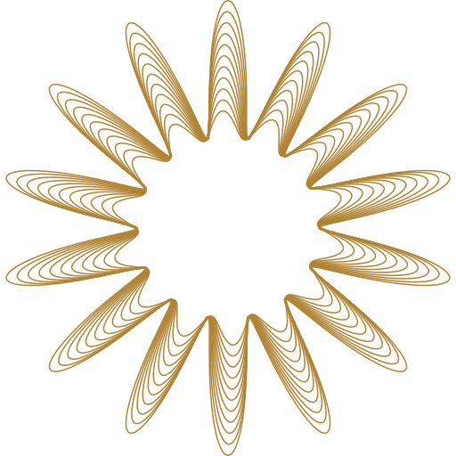

# The Pravaah seal

The official mark is a **guilloche rosette** — the figure a geometric lathe cuts when the
cutting head rides an eccentric while the plate turns. It is the mark on the note, not a
picture of one: fourteen petals, eleven nested curves, and a phase that walks across the
stack so the rings fan apart inside each petal and cross at the valleys.

That is also the argument for it. A rosette is defined by its parameters and cannot be
redrawn freehand, which is exactly why security printing puts one on a document. Pravaah
issues a credential; its mark is the same guarantee in miniature.



## Files

Every file here is generated. **Do not hand-edit them** — change `build.mjs` and re-run.

| File | Use |
| --- | --- |
| `pravaah-seal.svg` | **Master.** Display cut, `currentColor`. Use this everywhere. |
| `pravaah-seal-gold.svg` | Master in brand gold, for surfaces that cannot set `color`. |
| `pravaah-seal-standard.svg` | The 44–128px cut, `currentColor`. |
| `pravaah-seal-small.svg` | The ≤44px cut, `currentColor`. |
| `pravaah-icon.svg` | 1024² app icon: gold seal struck on the intaglio field. |
| `pravaah-icon-rag.svg` | The same on rag paper, for light print and letterhead. |

```
node brand/build.mjs          # SVG masters — zero dependencies
node brand/build.mjs --png    # also re-exports the app icons (needs sharp)
node brand/build.mjs --fit    # the accuracy table the encoder was tuned against
```

`--png` is opt-in because `sharp` is a native module and nothing else in the repo needs it.
The rasters it writes are committed, so a normal checkout never runs it.

## The construction

Each ring is a rosette in polar form, with the petal phase offset per ring:

```
r(t) = R + a·cos(p·t + φ)          p = 14 petals
```

Radii are fractions of **TIP**, the outermost petal-point radius, so the whole figure scales
from one number. The outer points are tangent to the viewBox — the mark's optical size *is*
its declared size, and no consumer has to guess at a margin.

| Parameter | Value | Why |
| --- | --- | --- |
| `PETALS` | 14 | Even, so points land at both 12 and 6 o'clock. |
| `RADIUS` | 0.70·TIP | With `AMPLITUDE`, puts the petal valley at exactly 0.40·TIP. |
| `AMPLITUDE` | 0.30·TIP | |
| `RADIUS_FALLOFF` | 0.35 | Each ring sits further in, so the stack keeps depth at the valleys instead of pinching to one line. |
| `AMPLITUDE_FALLOFF` | 0.80 | The waves flatten inward, so the core resolves to a near-circle and the eye finds a centre. |
| `TWIST` | 1.4 petals | **The whole mark.** The phase walk fans the rings apart inside each petal and crosses them at the valleys. It is also what makes the figure chiral. |
| `ROTATION` | −90° | A petal point at 12 o'clock. |

Ring *i* of *n* uses `k = i/(n−1)`:

```
R_i = TIP · 0.70 · (1 − 0.35k)
a_i = TIP · 0.30 · (1 − 0.80k)
φ_i = k · 2π · 1.4 / 14
```

### Three cuts

The mark has an optical size, the way a type family does. Eleven hairlines inside 40px is a
smudge, so as the seal shrinks it thins its stack and thickens its line. **Only three numbers
change** — the petal profile never does, so all three read as the same seal.

| Cut | Rings | Twist | Stroke (of box) | Use at |
| --- | --- | --- | --- | --- |
| `display` | 11 | 1.4 | 0.29297% | ≥128px — hero, print, the onboarding masthead |
| `standard` | 7 | 1.1 | 0.49% | 44–128px — app icons, headers |
| `small` | 5 | 0.9 | 0.72% | ≤44px — favicon, themed launcher icon |

The boundaries are measured, not guessed: each cut was rendered at 180, 87 and 40px and the
ranges put every surface on the cut that still resolves there. **Pick the cut by the size the
mark is *shown* at, not by the size of the file** — a 1024² themed launcher icon still lands
at about 48dp on a home screen, so it takes the small cut. Getting that backwards is the
usual way a mark turns to mush on a phone.

## Colour

One ink. The seal draws in **`#B08434`**, which is `latentLine` in
`apps/pravaah-rn/src/theme/tokens.ts` — the decorative gold of the existing design system,
not a new brand colour. The two grounds it is struck on are tokens too: `field` `#0E3B2E`
(the intaglio plate) and `ground` `#EEEFE7` (security rag paper).

DESIGN.md forbids `latentLine` from carrying information. The mark is consistent with that
rather than an exception to it: a logo is an identity, never a control or a status, and it
always appears beside the name it stands for. WCAG 2.2 exempts logotypes from the contrast
floor for the same reason. If the seal is ever the only thing telling a user something, add
the words — do not change the ink.

## Accuracy

The SVGs are cubic Béziers, not flattened polylines. Knots are sampled per petal and joined
with Hermite tangents from the analytic derivative, so the curve passes exactly through every
knot and is smooth across all of them.

Paths are emitted **relative**, which roughly halves the file. The hazard there is that
rounded deltas accumulate drift, so each delta is measured from the position a *parser* would
be at — the running sum of deltas already written — never from the true curve. `build.mjs`
verifies this by re-parsing its own output string and measuring that against the analytic
rosette, so a bug in the accumulator or in the number formatting would show up rather than
agreeing with itself.

At 10 cubics per petal and 2dp coordinates:

| Cut | Max deviation (512 box) | As a share of its stroke width |
| --- | --- | --- |
| `display` | 0.0323 | 2.15% |
| `standard` | 0.0342 | 1.36% |
| `small` | 0.0342 | 0.93% |

The share of *stroke width* is the number that matters, because it is the one that stays
constant as the mark scales. Two percent of a stroke width is below what any rasteriser can
resolve at any size. Past 16 cubics per petal the error stops falling anyway — 2dp coordinate
rounding becomes the floor. `--fit` prints the table.

## Where it is used

| Surface | Cut | Source |
| --- | --- | --- |
| RN onboarding masthead | display | `<Logo size={132} decorative />` |
| iOS app icon | standard | `assets/expo.icon/` (Icon Composer bundle) |
| Android adaptive icon | standard | `android-icon-foreground.png` on `#0E3B2E` |
| Android themed icon | small | `android-icon-monochrome.png` |
| Splash | standard | `splash-icon.png`, 120dp wide |
| Expo web favicon | small | `favicon.png` |
| Admin tab icon | small | `apps/pravaah-admin/app/icon.svg` |
| Admin sidebar | small | `apps/pravaah-admin/public/pravaah-seal.svg` |

In the RN app the mark is a component, not an asset: `components/ui/logo.tsx` generates the
same geometry at render and picks its cut from `size`. It is deliberately **not** folded into
`Rosette` in `components/ui/guilloche.tsx`, even though they draw the same family of curve —
`Rosette` is a decorative generator whose petal and ring counts are dials a screen may turn
for ornament, and if they shared an implementation, retuning a corner medallion would
silently restrike the logo. The constants are duplicated in the two places on purpose; change
one, change both.

## Clear space and minimum size

- **Clear space:** one petal length — 0.30 × the mark's width — on all four sides.
- **Minimum size:** 16px. Below that use a solid disc in `#B08434`; the guilloche is gone by
  then and a smudge is worse than an abstraction.
- Never re-colour, outline, add a gradient to, stretch, rotate, or crop the mark. Rotation in
  particular destroys it: the figure is chiral and the twist reads as a printing error once
  the 12 o'clock point moves.

## Legacy

`legacy/` holds the mark this replaced — an upward chevron, a *pravaah* (flow) rising, drawn
as a tapered peak with a notched underside, in a blue gradient. It was a vector reconstruction
measured off the shipped raster icons, accurate to 0.4px against a 1024² contour. Nothing in
the product references it any more.

Its geometry: a 7-vertex polygon, mirror-symmetric about the vertical axis, with a circular
fillet at each vertex, in a 660.054 × 594.038 box (a 10:9 mark). Blue field `#3EA1FF` → 
`#0172DE` vertical; the mark itself pure white under a vertical alpha ramp, 0.97 at the apex
to 0.42 at the tips. The full path is in `legacy/pravaah-mark.svg`.
